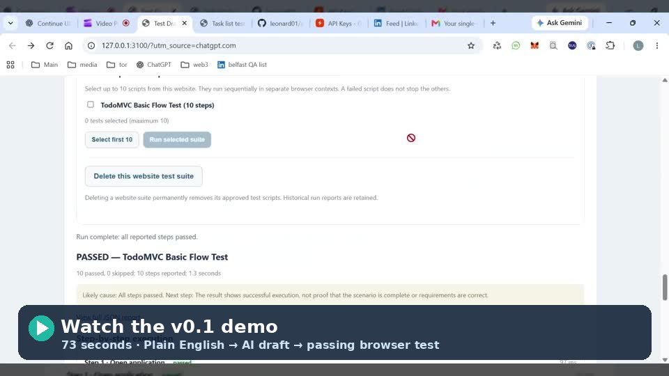

# AI UI Testing Agent

**v0.2 release candidate · AI-assisted browser test creation, review and execution · Playwright-powered**

**Describe a test in plain English, generate proposed browser steps, review or edit them, and execute the approved test.** No test automation code is needed for the primary web UI workflow.

> **Release status:** v0.2 functionality is on `main`, but no `v0.2.0` release has been published. This is a local QA prototype, not a production-ready autonomous test platform. `package.json` is still version `0.1.0`.

## Current functionality — implemented on `main`

| Capability | What you can do now |
| --- | --- |
| **Plain-English test creation** | Enter the website URL and natural-language instructions; GroqCloud uses a bounded initial-page snapshot to propose steps. **Fixture** mode works without AI. |
| **Human review** | Inspect and edit steps, locators and expectations. Approve individually or use **Add All**; nothing saves or executes without an explicit action. |
| **Incremental regeneration (v0.2)** | Use **Reinterpret with AI** on a selected step to replace only that step, or that step and all subsequent steps. Preview the proposal and reapprove changes while retaining unaffected approvals. |
| **Working drafts and test editing (v0.2)** | Save partly approved drafts, resume them later, preserve original and amended instructions, and edit existing tests or **Save as New Test**. |
| **Website suites and execution** | Organise saved scripts by website. Run one script or up to **10** sequentially in isolated Chromium contexts, with **5/10/15-second** step timeout options. |
| **Diagnostics and repair** | Review per-step results, timing, actual vs expected values, screenshots/traces when available, selector preflight and human-approved locator/assertion repairs. |
| **Application memory proof of concept (v0.2)** | Learn only limited per-website evidence of a successful shopping flow following login, and suggest login as an **unverified** prerequisite on later relevant tests. Opt-out supported; credentials are not stored in this memory. |
| **Requirements traceability** | Manually map requirements to test actions/assertions, see gaps and export a read-only coverage matrix. |
| **Portable Playwright export** | Export an approved script as standalone Playwright `.spec.ts`; later execution does not require the AI provider. |
| **Run history and developer tools** | Review historic executions by site; use CLI generation, execution and export; access Help and `.env.example` onboarding instructions. |

**Start here:** [Quick start](#quick-start) · [GroqCloud API setup](#groqcloud-api-setup) · [Demo video](#watch-the-demo-73-seconds) · [More feature details](#feature-details) · [Known limitations](#limitations-and-known-gaps) · [Documentation](#documentation)

## Quick start

Requires Node.js **22+**, npm and Playwright Chromium. Run these commands in a terminal:

```bash
git clone https://github.com/leonard01/ai-ui-testing-agent.git
cd ai-ui-testing-agent
npm ci
npx playwright install chromium
npm run start:demo
```

Open the **test builder** at **http://127.0.0.1:3100**. The sample website is at **http://127.0.0.1:3000**.

Enter a **test name**, the sample URL and an instruction such as *“Add a task called Prepare interview, verify it appears, complete it, then delete it and verify the list is empty.”* Choose **Fixture** to avoid AI calls, click **Generate draft**, review/approve the steps, save the script, then select the website under **Run Tests** and execute.

For existing clones, use `git switch main` and `git pull --ff-only`. Your local `.env` will not be overwritten.

## GroqCloud API setup

To generate real AI test steps, obtain an API key at [GroqCloud API Keys](https://console.groq.com/keys), then copy the repository template:

```bash
cp .env.example .env
```

Add your own key in `.env`:

```dotenv
GROQ_API_KEY=gsk_your_actual_key
GROQ_MODEL=openai/gpt-oss-20b
```

`GROQ_MODEL` is optional. Restart the server after editing. **Do not commit `.env` or share credentials.** GroqCloud quota limits apply; Fixture mode and running already approved tests do not require Groq requests.

## Watch the demo (73 seconds)

[](https://raw.githubusercontent.com/leonard01/ai-ui-testing-agent/main/assets/AI_UI_Testing_Agent_v0.1_LinkedIn_Demo.mp4)

**[▶ Play the demo video (MP4)](https://raw.githubusercontent.com/leonard01/ai-ui-testing-agent/main/assets/AI_UI_Testing_Agent_v0.1_LinkedIn_Demo.mp4)**

This recording shows the sample application, a plain-English test description, AI-generated steps, human approval, browser execution and the final passing result. No test automation code is written during the demonstration.

## Feature details

The table above summarises the current capabilities; the following gives more operational detail.

| Area | Implementation details |
| --- | --- |
| **AI-assisted test design** | Enter plain-English requirements and an application URL. Inspect a bounded snapshot of the live page and generate a structured test draft with **GroqCloud**. Use **Fixture** mode for a completely offline, prewritten demonstration (no AI). |
| **Human review and editing** | Read every proposed step in plain English, edit its action/locator/value/expectation, confirm steps individually or use **Add All**, then explicitly **Approve and save JSON test**. Generation and Add All never save or execute automatically. |
| **Structured test scripts** | Store validated, framework-neutral JSON definitions, including action steps, assertion provenance, optional requirement links and the originating website URL. Reject malformed definitions before browser execution. |
| **Website test suites** | Group approved scripts by website origin (scheme, host and port). Select a website and see **only its scripts** in both single-test and batch selectors. Edit/delete a script, or delete a website suite, with confirmation. Older unassigned scripts remain accessible. |
| **Browser execution** | Run one approved script or **1–10 scripts sequentially** in isolated Playwright Chromium contexts. Supported actions: navigate, click, fill, press keys, check/uncheck and select a native dropdown option. |
| **Assertions and diagnostics** | Verify exact or contained text (including dynamic prefixes/suffixes), visibility, URL and element counts. Display step-by-step pass/fail, timings and expected/observed values; attempt screenshots and Playwright traces on failures. |
| **Selector inspection and repair** | Run read-only selector preflight; locate targets from explicit roles, labels, placeholders, visible text or live DOM intent. Show human-reviewable alternatives for missing/ambiguous locators and failed assertions. Distinguish blocked clicks from selector failures. Approved repairs save a corrected script and rerun from step 1. |
| **Requirements traceability** | Optionally link requirements to steps/assertions **manually**, show coverage gaps and view/export a read-only requirements matrix. AI cannot claim human-confirmed mappings. |
| **Playwright export** | Download a standalone `.spec.ts` for an approved script or export via CLI. Generated specs run with `@playwright/test`, without this agent or an AI service. |
| **Execution history** | Review completed executions **by website suite** at the bottom of the UI. History is collapsed behind **Show History**, filtered by website and paginated **10 at a time**. Reopen saved results after restarting; **Delete All History** clears run artifacts without deleting approved scripts. |
| **Developer workflow** | TypeScript, Node.js, local demo application, command-line runner/generator/exporter and GitHub Actions type-check, unit and Playwright browser tests. |

**Important terminology:** A **test suite** is a website's collection of saved **test scripts**. A **suite execution** is one occasion on which you run one script or a selected batch. A test can fail without stopping other scripts in the same batch.

The **structured JSON definition** is framework-neutral; **the current browser runner uses Playwright**. A framework-free execution backend is a future goal, not a current capability.

## Setup and usage reference

The [Quick start](#quick-start) above is the shortest setup path. The details below cover alternative launch methods.

### Quick launch (Windows, macOS or Linux)

After one-time setup (`npm ci` and `npx playwright install chromium`), run either command from the project root:

| Command | What it does |
| --- | --- |
| `npm start` | Builds the project and runs the test review UI at **http://127.0.0.1:3100**. |
| `npm run start:demo` | Builds once and runs **both** the demo app at **http://127.0.0.1:3000** and the test review UI at **http://127.0.0.1:3100**. |

Leave the terminal running and use **Ctrl+C** to stop the server(s). The two Node servers run concurrently in the combined command, so one does not block the other. The original `npm run build`, `npm run review`, and `npm run demo` commands also remain available individually.

### 1. Install

```bash
git clone https://github.com/leonard01/ai-ui-testing-agent.git
cd ai-ui-testing-agent
npm ci
npx playwright install chromium
npm run build
```

For an existing checkout, run `git switch main`, `git pull --ff-only` and `npm run build` instead. Run `npm ci` again if dependencies have changed.

### 2. Start the demo website

In **terminal 1**:

```bash
npm run demo
```

The local task-list application is at **http://127.0.0.1:3000**. Use this for a reliable first test; you can later supply a different application URL.

### 3. Start the testing UI

In **terminal 2**, from the same repository:

```bash
npm run review
```

Open **http://127.0.0.1:3100**.

### 4. Create and run your first test

1. Enter `http://127.0.0.1:3000` as the **Application URL**.
2. Describe a task such as **“Add a task called Prepare interview, verify it appears, complete it, then delete it and verify the list is empty.”**
3. Set **Generate with → Prewritten demonstration (Fixture)** and choose **Generate draft**. This is a fixed test fixture—not a real AI response.
4. In **Review proposed steps**, inspect and edit the draft. Tick confirmations individually or click **Add All**. Click **Approve and save JSON test**.
5. Under **Run Tests**, select the website test suite and its approved test script, then click **Run selected test**. You can also select several scripts from that website and click **Run selected suite**.
6. Examine the step results. On a failure, review the diagnostic evidence and any suggested corrections; the tool never silently changes an expected result.

**Saving is not execution.** Each test run requires a separate action. The browser runs headlessly from the UI, and test execution does **not** call an AI model.

## Example workflow

```text
Requirements / application URL
        ↓
Optional AI-generated or Fixture draft
        ↓
Review, edit and approve steps (or Add All)
        ↓
Save approved JSON test script
        ↓
Choose website test suite → run one or several scripts
        ↓
Inspect pass/fail results, screenshots and traces
        ↓
Human-approved locator/expectation correction → rerun
        ↓
Reopen execution history or export standalone Playwright spec
```

**Real AI generation:** See [GroqCloud API setup](#groqcloud-api-setup) at the top. In the UI choose **GroqCloud**. Copy `.env.example` to `.env` in the repository root (`cp .env.example .env`), then set `GROQ_API_KEY` to your key from https://console.groq.com/keys. The optional `GROQ_MODEL` defaults to `openai/gpt-oss-20b`. Restart the app after editing `.env`; your local `.env` is gitignored and won't be overwritten by pulls. Alternatively, set `GROQ_API_KEY` in your environment. Groq's free tier has provider-imposed limits; availability and quotas can change. The key remains in the local server and should **never** be committed. In the CLI, you can also explicitly choose **Ollama** (local model) or **OpenAI** (usage may incur charges). No cloud provider is selected automatically.

## CLI and automation

The UI is optional; the same repository supports direct JSON execution and export:

```bash
# Run the existing nine-step local-demo case (demo server must be running)
npm run agent -- run examples/add-task.json

# Watch the browser
npm run agent -- run examples/add-task.json --headed

# Export portable Playwright TypeScript (does not execute it)
npm run agent -- export examples/add-task.json --base-url http://127.0.0.1:3000 --output generated/add-task.spec.ts

# Generate a draft without contacting AI
npm run generate -- generate --provider fixture --requirements examples/requirements-task-list.md --output generated/fixture-draft.json

# Type-check, build, unit tests, and browser integration tests
npm run typecheck
npm run build
npm run test:unit
npm test
```

Run results are saved under `run-results/` by default. Successful runs report `passed`; failures distinguish `assertion-failed` from `execution-error`. Later steps are marked `skipped` after a failure. Failure screenshots (`failure.png`) and traces (`trace.zip`) are captured when available; evidence-capture failures are recorded separately.

Run a saved trace with `npx playwright show-trace path/to/trace.zip`. The browser test suite uses its own isolated fixtures and can start the local demo automatically.

**CI:** GitHub Actions runs type-checking, build, unit/schema validation and Playwright browser tests. [PR #48](https://github.com/leonard01/ai-ui-testing-agent/pull/48) passed **105 tests** before merge; see [GitHub Actions](https://github.com/leonard01/ai-ui-testing-agent/actions) for the latest `main` verification.

## Limitations and known gaps

This prototype is meant to **demonstrate an end-to-end QA workflow**, not replace mature testing frameworks yet.

- **Playwright-backed execution only.** Additional runner backends, framework integrations and exporters beyond Playwright are not yet implemented.
- **Human oversight is required.** AI-generated steps and expectations can be incorrect. `Add All` is a bulk reviewer action, not independent validation. A green execution does not prove that requirements were specified correctly.
- **Live AI quality is not benchmarked.** CI uses fixtures/mocks rather than paid model calls. Real hosted-model output and reliability on arbitrary websites need further evaluation.
- **Web UI testing only.** No API/mobile/load testing, automatic exploration, recording browser interactions or interactive human–AI browser takeover in v0.1.
- **Protected production websites are not reliable demo targets.** The tool does not bypass CAPTCHA, robot checks, access controls or anti-bot protection. Prefer test environments and official test fixtures.
- **Selector repairs can be fragile.** Numbered choices for identically named elements rely on DOM order and can break if the page changes. Human approval and subsequent reruns remain necessary.
- **Execution history is operational, not an immutable audit log.** Replacing a saved test may remove the superseded test and some related evidence. Removing an approved website suite does **not** automatically erase its history; **Delete All History** is a separate, global action.
- **Single browser execution at a time.** Suite runs are serial and use isolated contexts, intentionally reducing pressure on less powerful machines. The UI is a local development tool, not a hosted multi-user service.

**v0.2 release status:** A final release/tag, package version bump and manual end-to-end smoke check are separate steps. A second hosted AI provider and generalized cross-workflow memory remain future work. Incremental regeneration sees the initial page snapshot, not the live page state after preceding steps.

## Documentation

| Guide | Focus |
| --- | --- |
| [Test review UI](docs/test-review-ui.md) | Step editing, Add All, execution and human-assisted repairs |
| [Requirements generation](docs/requirements-generation.md) | Groq, Ollama, OpenAI and Fixture configuration |
| [Website test suites](docs/website-test-suites.md) | Suite grouping, saved script organization and deletion |
| [Execution history](docs/persistent-history.md) | Restart recovery, pagination, deleting history and storage |
| [Standalone Playwright export](docs/playwright-export.md) | Portable specs and running them in another project |
| [Requirements traceability](docs/requirements-traceability.md) | Human-mapped requirements and coverage reports |
| [Live DOM discovery](docs/targeted-dom-discovery.md) | Intent locators, ambiguity and selector evidence |

## Troubleshooting

| Symptom | Check |
| --- | --- |
| `npm` not recognized | Install Node.js 22+ and reopen your terminal |
| Chromium missing | Run `npx playwright install chromium` |
| `Cannot find module dist/...` | Run `npm run build` |
| Port 3000 or 3100 already in use | Stop the previously running demo/review server |
| Test reports `assertion-failed` | Compare the approved expected and observed values |
| Test reports `execution-error` | Check selector ambiguity, blocked clicks, timeouts or off-origin navigation |
| Real AI generation unavailable | Check the configured provider/key; Fixture needs no AI credentials |
| Robot check appears | Use an automation-friendly test environment; bypassing bot checks is out of scope |

## Contributing

Feedback, defect reports and reproducible examples are welcome through [GitHub Issues](https://github.com/leonard01/ai-ui-testing-agent/issues).

**Guiding principles:** explicit approvals; test expectations from requirements rather than observed bugs; reproducible browser runs; clear failure evidence; optional AI assistance; and portable, reviewable test definitions.
